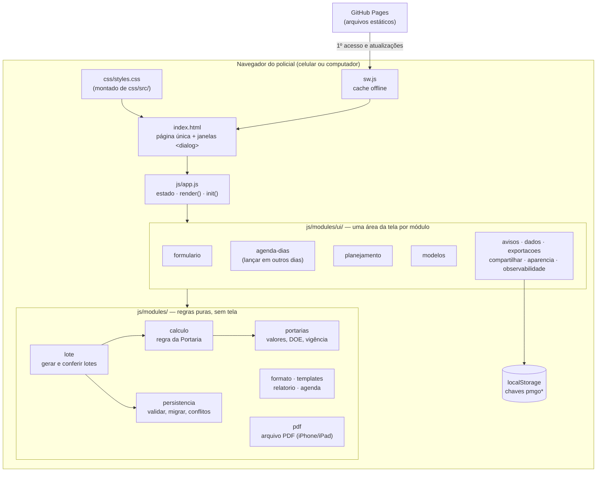
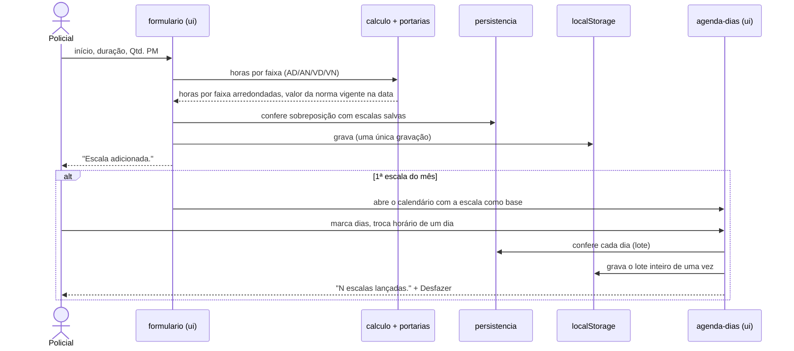

# Arquitetura — Calculadora AC4

Retrato da aplicação na v81. Tudo roda no navegador do usuário: não há servidor, banco de
dados, login nem dependências em produção. O site é publicado como arquivos estáticos no
GitHub Pages, e os dados ficam só no aparelho.

## Visão geral

**Regras de convivência** (conferidas por testes automáticos):

- Módulo de interface **não importa** outro módulo de interface. O `app.js` cria todos e passa a cada
  um só o que ele usa (`criarX(ctx)`).
- Regra de cálculo e de validação fica nos módulos puros, que não tocam a tela e por isso são
  testados isoladamente.
- A Portaria tem uma **fonte única** (`portarias.mjs`): valores, publicação no Diário Oficial e
  vigência. Norma nova entra no fim da lista; uma publicada nunca é editada.
- Dado do usuário entra na tela só como texto (`textContent`), e a política de segurança (CSP)
  bloqueia estilo e script embutidos.

## Caminho de um lançamento

## Onde mexer para…

| Mudança | Onde | Cuidado |
| --- | --- | --- |
| Nova Portaria ou valor | `js/modules/portarias.mjs` (entrada nova no fim) | Atualizar `.tariff-strip` no `index.html` e [portaria-ssp-621-2026.md](portaria-ssp-621-2026.md); teste "Fonte única da Portaria" |
| Regra de horas | `js/modules/calculo.mjs` | Suíte "Conformidade com o Anexo I"; cada faixa arredondada para a hora mais próxima, como a planilha (decisão do gestor, v93) |
| Lançar em outros dias | regra em `js/modules/lote.mjs`, tela em `js/modules/ui/agenda-dias.mjs` | Suíte "Lançamento em lote" e roteiro do lote em `tests/mobile-check.mjs` |
| Relatório PDF | dados em `js/modules/relatorio.mjs` (`dadosRelatorio`, `COLUNAS_RELATORIO`); impressão no CSS `@media print` de `css/src/95-rodape-impressao.css`; arquivo do iPhone/iPad em `js/modules/pdf.mjs` | Coluna nova: mudar `COLUNAS_RELATORIO` e as larguras do CSS juntas (suíte "PDF do iPhone" e passos de PDF no smoke) |
| Visual | `css/src/NN-area.css` + `node tools/montar-css.mjs` | Nunca editar `css/styles.css`; letra ≥ 12/14 px ([DESIGN.md](DESIGN.md)) |
| Texto da tela | `index.html` ou o módulo de interface | Teste "Textos preservados" e fotografia de equivalência |
| Versão publicada | `node tools/bump-version.mjs <n>` | Entrada nova no [CHANGELOG](../CHANGELOG.md) |

## Como a qualidade é garantida

Nenhuma mudança chega ao site sem passar por um pull request com o check `test` verde. A
proteção da `main` vale inclusive para administradores. O `npm run verify` roda:

| Suíte | O que prova |
| --- | --- |
| `lint` | Código sem erros comuns |
| `test:unit` (`tests/run-tests.mjs`) | Cálculo da Portaria (Anexo I e escalas reais), persistência, lote, módulos, piso de fonte, CSS montado, links dos documentos |
| `test:smoke` | Fluxo completo em Chrome: lançar, editar, exportar, PDF, backup, atualização |
| `test:equivalencia` | Lista, totais, PDF, CSV e texto compartilhado iguais à referência gravada |
| `test:mobile` e `test:mobile-v55` | Celular de 320 a 393 px: alvos de toque, rolagem, fonte, agenda de lote, janelas |
| `test:vitals` | Estabilidade de layout e tempo de resposta das interações principais |

Depois do merge, o deploy publica o site e a publicação é conferida no endereço real.
